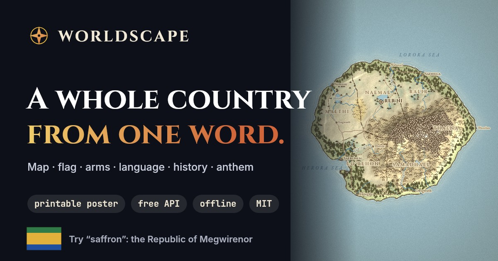
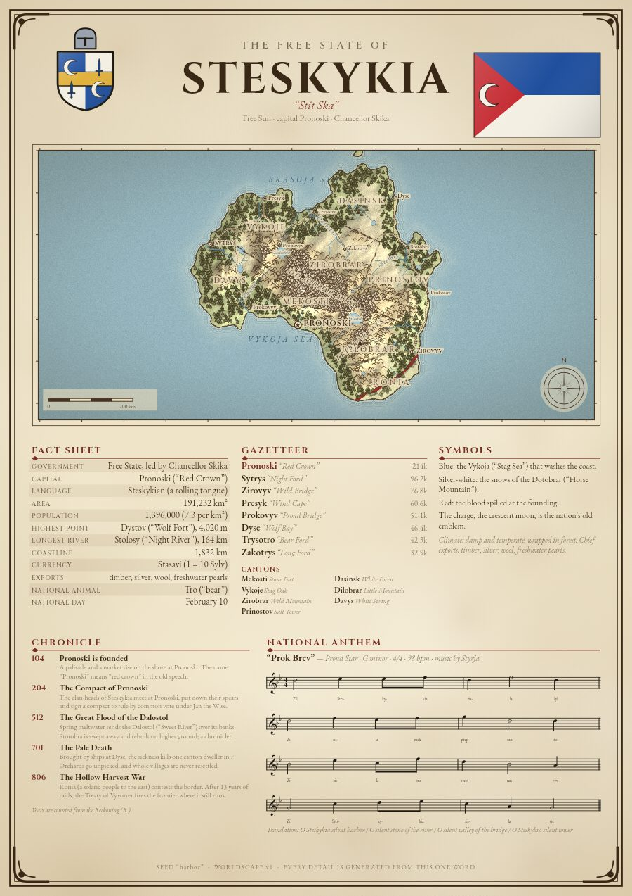
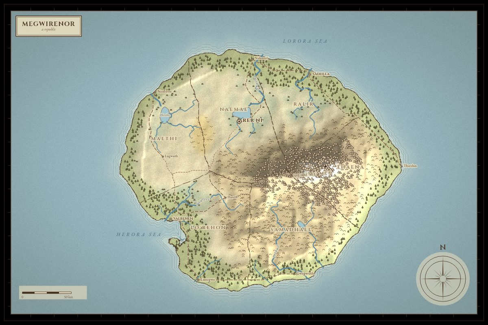
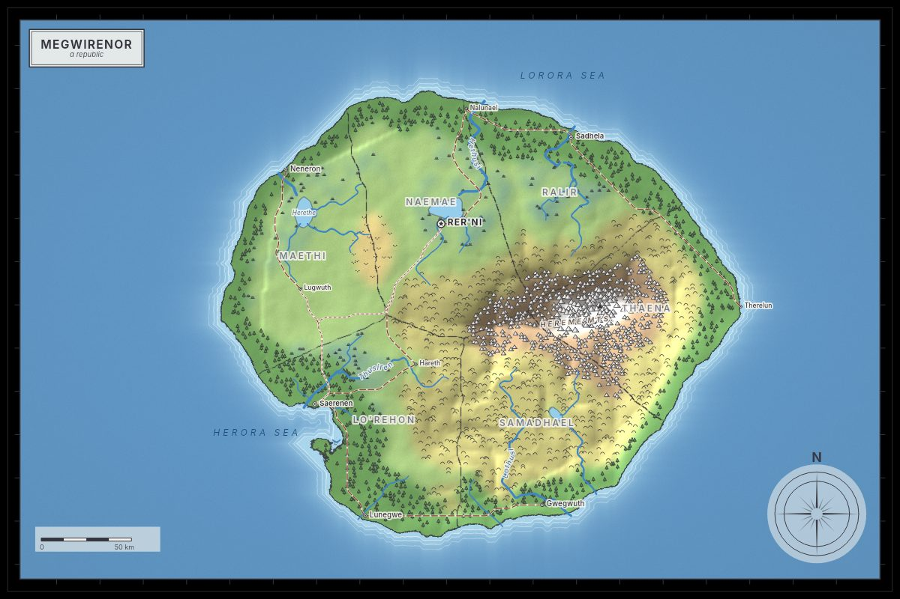
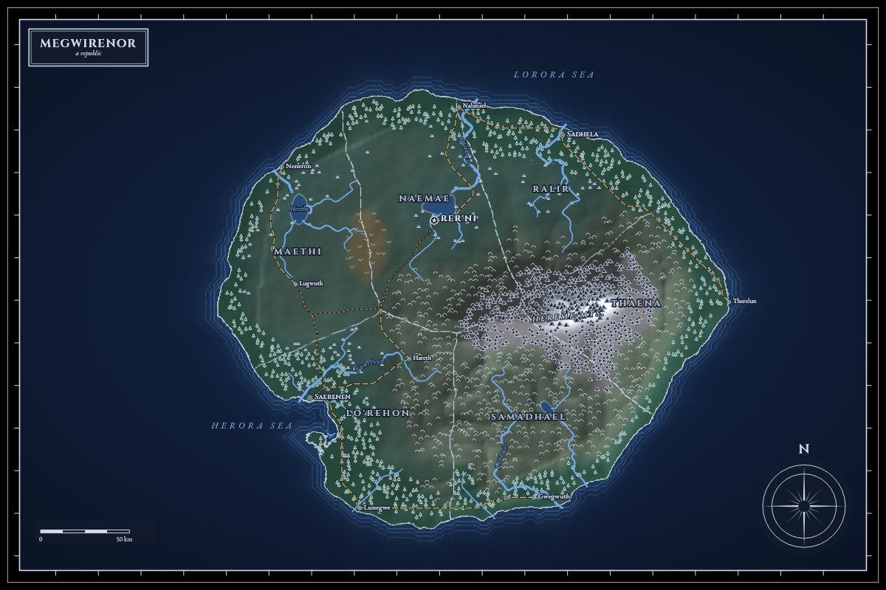
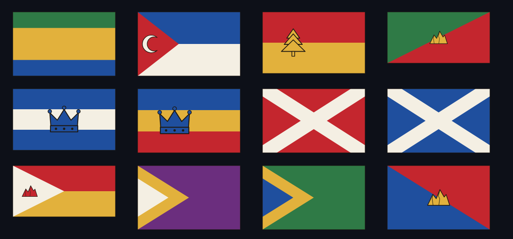
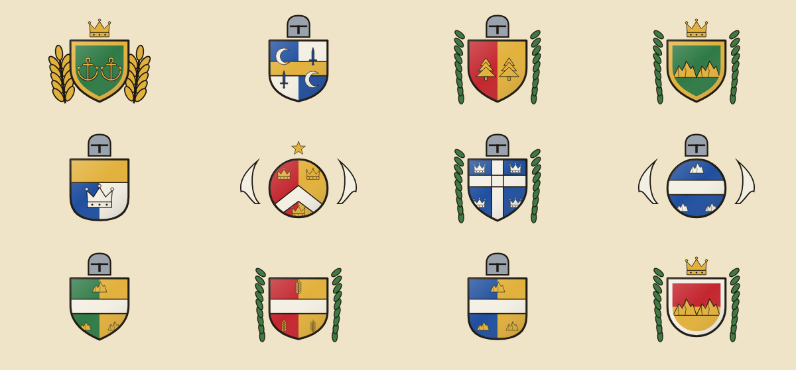
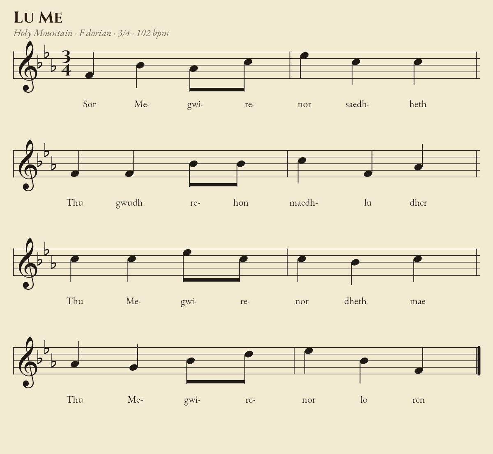

<div align="center">



# Worldscape

**Type one word. Get a whole country.**<br>
A parchment map, a flag, a coat of arms, a language behind every place name, a chronicle of its history and an anthem you can play. Printable as a poster.

[**Try it live →**](https://worldscape.vercel.app/app) · [API docs](https://worldscape.vercel.app/docs) · [Example country](https://worldscape.vercel.app/app?seed=saffron)

[](https://github.com/mskraban/worldscape/actions/workflows/ci.yml)
[](LICENSE)


</div>

---

<p align="center"></p>

## Why

Every tabletop campaign, novel and classroom needs a place that does not exist yet. Worldscape makes one in a second, and **the same word always makes the same place**, so you can share it by sending a single word.

- 🗺️ **A real-looking map**: coastlines, rivers that flow downhill, ranges, forests, roads, provinces, neighbours. Three styles: parchment, atlas, night.
- 🏳️ **Flag and coat of arms** built from heraldic rules, with symbols taken from the land: anchors for islands, mountains for highlands, wheat for plains.
- 🗣️ **An invented language.** Ten phonologies, each with its own vocabulary. “Salodin” really is “Old Harbor”, and the glossary says so.
- 📜 **A chronicle** that names the country's actual rivers, peaks, ports and neighbours: founding, floods, plagues, wars, a constitution.
- 🎼 **An anthem**: lyrics in the national tongue with a translation, a melody fitted to the syllables, engraved sheet music, in-browser playback and MIDI download.
- 🖨️ **A printable poster** on A-series proportions. Download at 150 or 300 dpi, or print from the browser.
- 🔌 **A free API**: every piece is a URL. No key.
- 🔒 **Offline and private.** The generator runs entirely in your browser. No AI, no tracking, no accounts.

## Gallery

| Parchment | Atlas | Night |
|:--:|:--:|:--:|
|  |  |  |

<p align="center"> </p>
<p align="center"></p>

## Quick start

```bash
git clone https://github.com/mskraban/worldscape.git
cd worldscape
npm install
npm run dev        # http://localhost:3000
```

Or just open `public/app.html` through any static server: the generator needs nothing else.

## The API

Everything is a `GET`. Responses for a seed are cached for a year because they never change.

```text
/api/poster?seed=saffron&width=1240          A-series poster (jpeg, png, webp)
/api/map?seed=saffron&style=atlas            map (parchment | atlas | night)
/api/flag?seed=saffron&width=600             flag PNG
/api/arms?seed=saffron                       coat of arms, transparent PNG
/api/anthem?seed=saffron                     Standard MIDI file
/api/anthem?seed=saffron&format=png          sheet music
/api/country?seed=saffron                    everything as JSON
/api/random                                  a fresh seed with all the links
```

Short forms: `/flag/saffron`, `/map/saffron`, `/poster/saffron`, `/c/saffron`, `/random`. Drop them straight into Markdown:

```markdown

```

The [full reference](https://worldscape.vercel.app/docs) lists every parameter and limit. It is generated from the code (`npm run docs`), so it cannot drift.

## Use the engine in your own project

The engine is one file with no dependencies. It runs in browsers and Node and generates the country; drawing needs any Canvas 2D context.

```js
const W = require('./public/engine.js');         // or <script src="engine.js">
const country = W.generateCountry('saffron');

country.geo.name;                 // "Megwirenor"
country.geo.cities[0];            // { name: "Rer'Ni", en: "Wheat Crown", pop: 158300, … }
country.state.government;         // "Republic"
country.history.events;           // dated chronicle
W.anthemMidi(country.anthem);     // Uint8Array (a .mid file)

W.drawMap(ctx, country, 0, 0, 1600, 1000, { style: 'atlas' });
W.drawPoster(ctx, country, 1240, 1754);
```

## How it works

Nothing here is a model. Every part is an ordinary algorithm:

| Part | Technique |
|------|-----------|
| Randomness | One hash of the seed feeds independent streams per feature (`seed + tag`), so adding a feature never disturbs the others |
| Terrain | Value noise, shaped per country type; sea level from an elevation quantile |
| Rivers | Priority-flood drainage with random tie-breaking, so rivers meander; flow accumulation sets their width |
| Borders and provinces | Weighted flood-fills that prefer to follow ridges; Lloyd relaxation for balanced provinces |
| Cities and roads | Site scoring (coast, river, plains); minimum spanning tree, then Dijkstra with a terrain cost |
| Language | Ten phonologies, a ~70-concept vocabulary and a compound grammar, with English glosses |
| Heraldry | Rule of tincture, charges chosen from the geography |
| Anthem | Lyrics first; the melody is then fitted to their syllables in a diatonic mode picked by the tongue's character |
| Map | One per-pixel pass for sea, relief and borders, then vector layers and a label collision pass |

**The determinism contract.** Generation uses only integer maths and `+ − × ÷ √`, so every JavaScript engine agrees to the last bit. A test freezes the output for eight seeds; changing what a seed produces needs a `VERSION` bump.

## Project layout

```text
src/            engine source, concatenated by `npm run build` into public/engine.js
public/         the website (static) and the built engine
api/ lib/       the serverless API (Vercel) and its renderer
scripts/        build, assets, docs, dev server
test/           determinism, invariants, API and SEO tests
```

## Deploy your own

It is a plain Vercel project: import the repo, no settings needed (`vercel.json` includes everything). Any host that serves `public/` works for the generator; the API needs Node 20+.

## FAQ

**Can I use the results commercially?** Yes. Maps, flags, posters and anthems are yours. Credit is appreciated, never required.

**Does the same seed always give the same country?** Yes, within one engine version. The API returns the version in the `X-Worldscape-Engine` header.

**Why no AI?** It runs offline, costs nothing to host, gives the same answer every time, and every detail is explainable. That is the point.

## Contributing

New languages, flag symbols, history events and map styles are all welcome. See [CONTRIBUTING.md](CONTRIBUTING.md). Please read the “seeds must not change” rule first.

## Licence

[MIT](LICENSE). Bundled fonts are under the SIL Open Font License; see [NOTICE.md](NOTICE.md).

<p align="center"><sub>Also by the author: <a href="https://github.com/mskraban/seedscape">Seedscape</a>, generative wallpapers from a single word.</sub></p>
